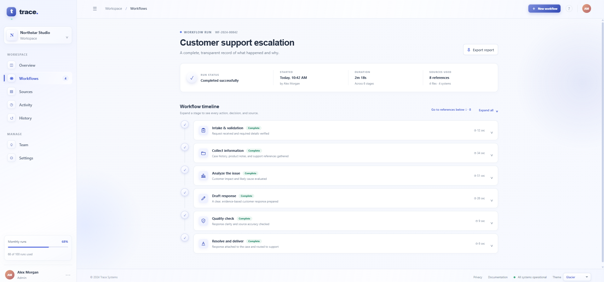
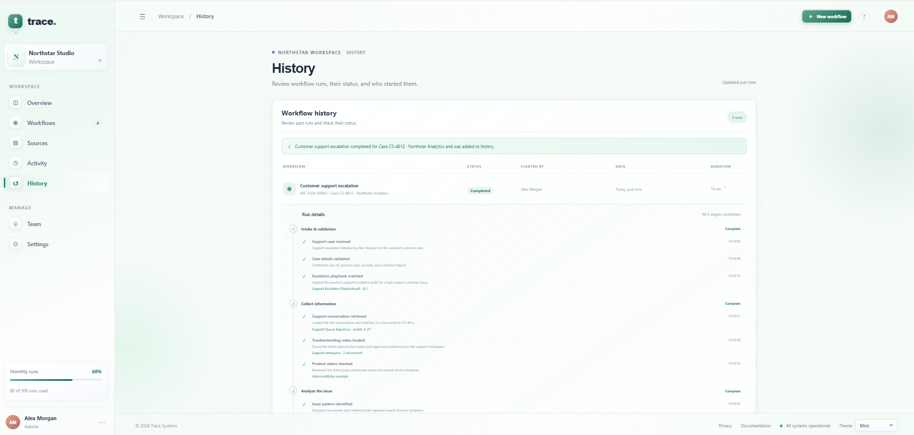
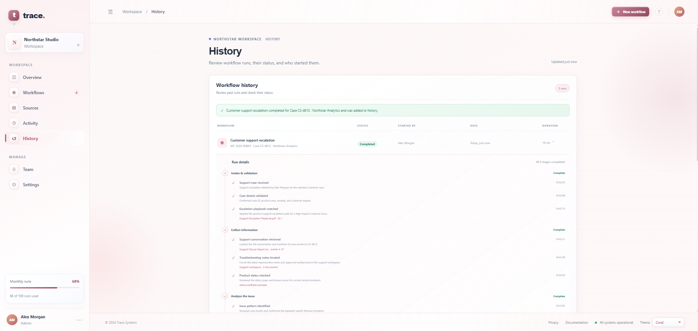

# Trace — Customer Support Workflow UI

Trace is a front-end prototype for exploring customer-support workflow runs. It shows stage-by-stage activity, source references, run progress, and history in a responsive workspace with three light themes.
Live URL: https://workflow-trace.netlify.app/ 

> **Prototype:** workflow runs, progress, history, metrics, and source data are simulated in the browser. This sample does not connect to a customer-support platform or backend and should not be used with real customer data.

## Run locally

### Requirements

- Node.js **22.22.3 or newer in the 22.x line**, or a supported newer major release (24.15.0+ or 26.0.0+).
- npm (installed with Node.js).

### Start the development server

```bash
npm install
npm start
```

Open the URL printed by Angular CLI, usually [http://localhost:4200](http://localhost:4200).

To create a production build:

```bash
npm run build
```

## Screenshots

Screenshots are in [`docs/screenshots`](docs/screenshots/).

### Workflow details — Glacier theme



### History — Mint theme



### History — Coral theme



## Project structure

- `src/app/app.component.*` — shared application shell, header, footer, and navigation
- `src/app/pages/` — separate Angular components for the application screens
- `src/app/workflow-state.service.ts` — shared navigation, theme, workflow, and history state
- `src/app/models/` — TypeScript data models
- `src/styles.css` and `src/app/app.component.css` — global theme and shell styling
- [`initial_prompt.md`](initial_prompt.md) — the prompt used as a starting point for this original prototype

## Notes

- The screenshots show sample workspace content and fictional people and organizations.
- Theme selection and workflow state are client-side prototype behavior; data is not persisted to a server.
- This project is a UI demonstration, not a production customer-support system.
- The code is released under the [MIT License](LICENSE).
